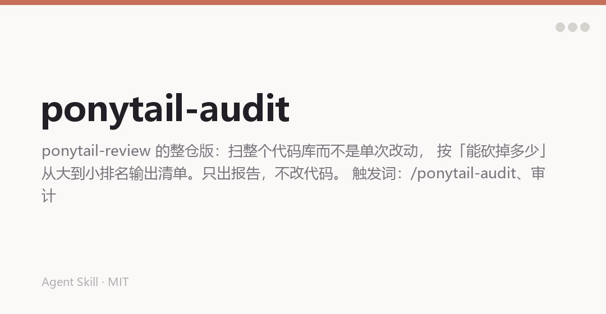

# 公子教代码做事 · 整仓审计

【全仓过度设计审计】ponytail-review 的整仓版：扫整个代码库而不是单次改动， 按「能砍掉多少」从大到小排名输出清单。只出报告，不改代码。 触发词：/ponytail-audit、审计整个项目、这个仓库能删什么、找膨胀。

## 📺 看看效果



> 把 `screenshots/hero.png` 换成真实效果图（建议 1200px 宽、不超过 400KB）

## What This Does

【全仓过度设计审计】ponytail-review 的整仓版：扫整个代码库而不是单次改动， 按「能砍掉多少」从大到小排名输出清单。只出报告，不改代码。 触发词：/ponytail-audit、审计整个项目、这个仓库能删什么、找膨胀。

### Key Features

- Tags
- Hunt
- Output
- Boundaries

## Installation

### WorkBuddy

```bash
git clone https://github.com/<you>/ponytail-audit.git ~/.workbuddy-ai/skills/ponytail-audit
pip install -r ~/.workbuddy-ai/skills/ponytail-audit/requirements.txt
```

### Claude Code / 其他 Agent

```bash
mkdir -p ~/.claude/skills/ponytail-audit
cp -R SKILL.md README.md requirements.txt scripts references \
      ~/.claude/skills/ponytail-audit/
```

把仓库链接丢给 agent，它会按 `SKILL.md` 加载所需文件。

## Usage

触发词：**/ponytail-audit、审计整个项目、这个仓库能删什么、找膨胀**

## Architecture

| 文件 | 作用 |
|---|---|
| `SKILL.md` | 触发条件与流程 |

## Requirements

- Python 3.9+
- `pip install -r requirements.txt`

## Credits

基于 [Ponytail](https://github.com/DietrichGebert/ponytail)（MIT，作者 DietrichGebert）改写 · 中文版维护 [@chengangrun-ai](https://github.com/chengangrun-ai)

Created by 公子 · [@你的GitHub](https://github.com/).

## License

MIT — Use it, modify it, share it.
